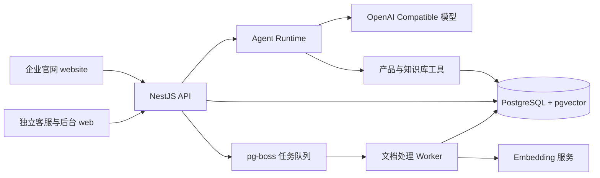

<div align="center">
  

  # 禾序智能客服

  面向产品咨询与企业知识服务的智能客服示例项目。

  [企业官网](https://hexu.7410000.xyz/) · [管理后台](https://hexu-admin.7410000.xyz/admin)
</div>

## 项目简介

禾序智能客服将产品目录、企业知识库和对话 Agent 连接起来：访客可以在官网浏览产品、引用产品提问，也可以进入独立对话页；管理员负责维护产品、知识、模型、Agent 配置和接入应用。项目适合学习完整的智能客服链路，以及在已有网站中接入 AI 助手的实现方式。

线上 Demo 使用示例数据。产品名称或图片来自其各自品牌，不表示本项目与相关品牌存在授权或合作关系；产品参数和价格以官方信息为准。

## 在线体验

| 入口 | 地址 | 可以体验什么 |
| --- | --- | --- |
| 企业官网 | [hexu.7410000.xyz](https://hexu.7410000.xyz/) | 首页、产品筛选与详情、站内助手 |
| 管理后台 | [hexu-admin.7410000.xyz/admin](https://hexu-admin.7410000.xyz/admin) | 产品、知识库、模型与接入配置；需管理员账号 |

## 核心能力

- **产品咨询**：后台维护产品与规格；官网产品页可带入产品，聊天中也可选择最多 5 个产品，服务端按产品 ID 读取详情并准备首次回答上下文。
- **知识库检索**：上传 Markdown、DOCX 和可复制文字的 PDF；Worker 异步解析、切片与索引，支持词法、向量及融合检索。
- **Agent 对话**：模型通过 OpenAI Compatible 接口返回原生 `tool_calls`；Agent 可查询知识库和产品，并将可复用的资料纳入同一会话的后续上下文。
- **流式交互**：SSE 返回公开的处理说明、工具进度和回答文本；会话、草稿与未完成请求可在浏览器刷新后恢复。
- **后台配置**：可管理回答模型、Embedding 服务、Agent 人设与记忆、知识库、产品和会话轨迹。
- **外部接入**：支持授权域名的网站访客接入，以及使用 API Key 的服务端接入；提供权限、并发和每日请求／Token 配额。

## 系统结构



前端不持有模型密钥。API 负责访客身份、权限、会话、配额和 Agent 编排；Worker 负责文档处理与向量生成。回答模型使用 OpenAI Compatible 接口；Embedding 可配置火山方舟、OpenAI 或其他兼容服务。

## 技术栈与目录

| 目录 | 技术 | 主要职责 |
| --- | --- | --- |
| [`website/`](website/) | Vue 3、TypeScript、Vite、GSAP | 企业官网、产品展示和站内助手 |
| [`web/`](web/) | Vue 3、TypeScript、Vite、Tailwind CSS | 管理后台与客服运行界面 |
| [`server/`](server/) | NestJS、TypeScript、Drizzle ORM、pg-boss | API、Agent、工具、权限、索引 Worker |
| [`infra/`](infra/) | PostgreSQL、pgvector | 数据库初始化 |
| [`deploy/`](deploy/) | Docker Compose、Caddy | 生产部署与检查脚本 |
| [`docs/`](docs/) | Markdown | 设计、配置、接入和运维说明 |

## 快速开始

需要 Node.js 22.18+、npm 和 Docker。先准备本地配置：

```bash
cp .env.example .env
```

至少设置 `.env` 中的 `POSTGRES_PASSWORD` 和长度不少于 32 字节的 `JWT_SECRET`。要使用实际模型回答和向量检索，还需在后台配置相应服务，或填写本地模型／Embedding 环境变量；不要将密钥提交到 Git。

**Docker 启动后台服务：**

```bash
docker compose up --build -d
docker compose ps
```

打开 [http://localhost:8081](http://localhost:8081/)；管理后台位于 `/admin`。首次使用后台时，运行 `docker compose run --rm -it api node dist/admin/bootstrap.js` 创建超级管理员。此命令仅在管理员表为空时有效。

**本地热更新开发：**

```bash
cd server && npm ci
cd ../web && npm ci
cd ../website && npm ci
cd ..
node scripts/dev-supervisor.mjs
```

开发监督进程使用 Docker 数据库，保持 API、Worker 和 `web` 在线；管理后台访问 [http://localhost:8848/admin](http://localhost:8848/admin)。另开终端运行 `cd website && npm run dev`，企业官网访问 [http://localhost:8849](http://localhost:8849/)；官网的产品和对话依赖 API 在线。开发与生产部署细节见 [官网说明](website/README.md) 和 [生产部署文档](docs/production-deployment.md)。

## 关键流程

1. 管理员维护产品，并将企业资料上传到知识库；Worker 生成可检索的片段与向量。
2. 访客从企业官网提问，可附带产品引用；API 校验产品 ID，预先准备相关产品资料和检索结果。
3. Agent 将当前问题、会话上下文和已准备的资料交给模型；模型可以直接回答，也可以调用产品或知识库工具补充信息。
4. 页面通过 SSE 展示公开处理过程和回答；会话、轨迹与用量留在服务端，后续追问可复用有效的上下文资料。

## 开发与验证

```bash
cd server && npm test
cd ../web && npm test && npm run build
cd ../website && npm test && npm run build
```

这些命令分别检查后端、管理后台与官网。外部模型调用、真实产品资料和生产接入还需要在对应环境单独验证。

## 深入阅读

- [Agent 配置与工具执行](docs/agent-configuration.md)
- [知识库与检索](docs/knowledge-base-v1.md)
- [回答模型服务](docs/model-service-config.md)与 [Embedding 服务](docs/embedding-services.md)
- [网站与平台接入](docs/integration-access.md)
- [权限与安全边界](docs/security-policy.md)
- [生产部署与备份](docs/production-deployment.md)

## 当前边界

本项目用于学习和演示，线上数据不应视为实时库存、售价或官方售后承诺。模型回答依赖已配置的模型服务、产品资料和知识库内容；对重要业务结论仍需人工核对。管理员后台需要单独登录，公开 Demo 不提供管理权限。
