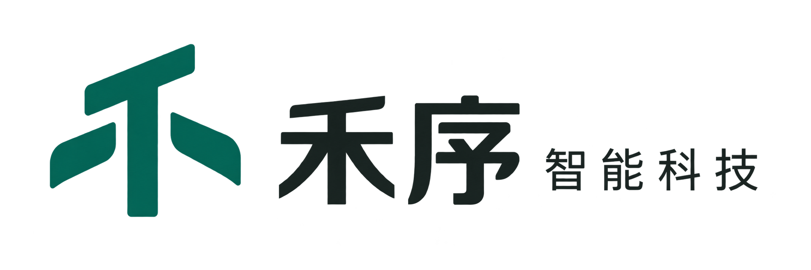

<div align="center">
  

  # 禾序智能客服

  面向产品咨询与企业知识服务的智能客服示例项目。

  [企业官网](https://hexu.7410000.xyz/) · [管理后台](https://hexu-admin.7410000.xyz/admin)
</div>

## 项目简介

这是一个用于学习 Agent 开发的智能客服项目。禾序是虚拟企业，示例产品资料来自公开网络，仅用于学习和演示，不代表相关品牌的授权、代理或合作关系。

项目以一个面向 C 端用户的产品客服为例：用户可以浏览产品目录和详情、引用产品进行提问、查询产品规格与使用建议、搜索企业知识，以及在连续对话中获得基于资料的回答。后台提供产品、知识库、模型和 Agent 配置，用来支撑这些体验。

线上 Demo 使用示例数据。产品名称或图片来自其各自品牌，不表示本项目与相关品牌存在授权或合作关系；产品参数和价格以官方信息为准。

## 在线体验

| 入口 | 地址 | 可以体验什么 |
| --- | --- | --- |
| 企业官网 | [hexu.7410000.xyz](https://hexu.7410000.xyz/) | 首页、产品筛选与详情、站内助手 |
| 管理后台 | [hexu-admin.7410000.xyz/admin](https://hexu-admin.7410000.xyz/admin) | 产品、知识库、模型与接入配置；需管理员账号 |

## 核心能力

- **Agent Loop**：实现“模型规划 → 工具调用 → 结果回传 → 再规划或回答”的完整循环，支持直接回答、连续工具调用、工具结果复用、上下文记忆和基础运行轨迹。
- **RAG + Tool / MCP**：Agent 可以通过知识库检索、产品目录等工具获取外部事实；工具注册、参数校验、权限、超时、重复调用和结果归一化由后端统一处理，并保留 MCP 适配扩展点。
- **可扩展能力**：新增工具只需实现统一的 Tool 接口并注册到 Tool Registry；专项流程可以通过 Skill 提供指导；后续可继续增加业务工具、外部 MCP 服务和不同的 Agent 策略，而不需要重写主循环。
- **产品与知识回答**：支持产品引用、产品详情预加载和跨轮资料复用，减少重复查询；知识库支持词法、向量及融合检索。
- **流式交互**：通过 SSE 返回公开处理说明、工具进度和回答文本，会话和未完成请求可以恢复。
- **基础支撑能力**：后台配置模型、Embedding、Agent 人设与记忆、知识库和产品数据；同时提供网站接入与服务端 API 接入能力。

## 技术栈

### Agent 与后端

- **NestJS + TypeScript**：提供模块化 API、会话、权限、配额和后台管理能力。
- **Agent Runtime**：由 Agent Loop、Agent Runner 和上下文构建器组成，负责组织模型规划、工具执行、资料复用与最终回答；会话持久化和 HTTP 接入由外层服务处理。
- **Tool Registry**：统一注册工具、定义参数 Schema、执行策略、超时、权限和结果格式；当前接入知识库检索和产品目录工具，并保留 MCP Adapter 扩展点。
- **Skill Registry**：将专项业务流程作为可加载指导，与基础 Agent 提示词和工具执行逻辑分离。
- **RAG**：PostgreSQL + pgvector 保存文档、片段和向量，支持词法、向量与 RRF 融合检索；pg-boss 负责异步文档处理。
- **模型适配**：通过 OpenAI Compatible Provider 统一接入回答模型和原生 `tool_calls`，将不同供应商的响应归一化为 Agent 可使用的格式。

### 前端

- **Vue 3 + TypeScript + Vite**：实现企业官网、产品页面、客服对话和管理后台。
- **Tailwind CSS / 组件化样式**：统一页面布局、表单、对话消息和后台管理界面。
- **SSE 流式渲染**：展示公开处理过程、工具进度和回答文本，并支持会话恢复。

## 快速开始

需要 Node.js 22.18+、npm 和 Docker。先准备本地配置：

```bash
cp .env.example .env
```

至少设置 `.env` 中的 `POSTGRES_PASSWORD` 和长度不少于 32 字节的 `JWT_SECRET`。要使用实际模型回答和向量检索，还需在后台配置相应服务，或填写本地模型／Embedding 环境变量；不要将密钥提交到 Git。

**Docker 启动后台服务：**

```bash
docker compose up --build -d
docker compose ps
```

打开 [http://localhost:8081](http://localhost:8081/)；管理后台位于 `/admin`。首次使用后台时，运行 `docker compose run --rm -it api node dist/admin/bootstrap.js` 创建超级管理员。此命令仅在管理员表为空时有效。

**本地热更新开发：**

```bash
cd server && npm ci
cd ../web && npm ci
cd ../website && npm ci
cd ..
node scripts/dev-supervisor.mjs
```

开发监督进程使用 Docker 数据库，保持 API、Worker 和 `web` 在线；管理后台访问 [http://localhost:8848/admin](http://localhost:8848/admin)。另开终端运行 `cd website && npm run dev`，企业官网访问 [http://localhost:8849](http://localhost:8849/)；官网的产品和对话依赖 API 在线。开发与生产部署细节见 [官网说明](website/README.md) 和 [生产部署文档](docs/production-deployment.md)。

## 关键流程

1. 管理员维护产品，并将企业资料上传到知识库；Worker 生成可检索的片段与向量。
2. 访客从企业官网提问，可附带产品引用；API 校验产品 ID，预先准备相关产品资料和检索结果。
3. Agent 将当前问题、会话上下文和已准备的资料交给模型；模型可以直接回答，也可以调用产品或知识库工具补充信息。
4. 页面通过 SSE 展示公开处理过程和回答；会话、轨迹与用量留在服务端，后续追问可复用有效的上下文资料。

## 开发与验证

```bash
cd server && npm test
cd ../web && npm test && npm run build
cd ../website && npm test && npm run build
```

这些命令分别检查后端、管理后台与官网。外部模型调用、真实产品资料和生产接入还需要在对应环境单独验证。

## 深入阅读

- [Agent 配置与工具执行](docs/agent-configuration.md)
- [知识库与检索](docs/knowledge-base-v1.md)
- [回答模型服务](docs/model-service-config.md)与 [Embedding 服务](docs/embedding-services.md)
- [网站与平台接入](docs/integration-access.md)
- [权限与安全边界](docs/security-policy.md)
- [生产部署与备份](docs/production-deployment.md)

## 当前边界

本项目用于学习和演示，线上数据不应视为实时库存、售价或官方售后承诺。模型回答依赖已配置的模型服务、产品资料和知识库内容；对重要业务结论仍需人工核对。管理员后台需要单独登录，公开 Demo 不提供管理权限。
